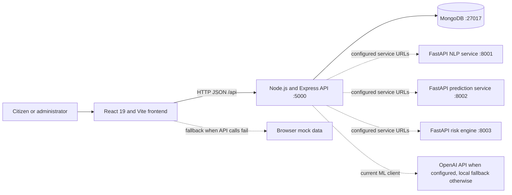

# SCC&DP: Smart City Complaint and Disaster Prediction Platform

SCC&DP is a web application for submitting and managing civic complaints, viewing complaint and risk information on maps, and presenting disaster-related guidance. The repository contains a React frontend, an Express API, MongoDB models, and three Python FastAPI services. Some UI data and backend ML paths use mock or deterministic fallback behavior; see [Implementation notes](#implementation-notes) before interpreting predictions as operational forecasts.

- Live frontend: [scc-dp.vercel.app](https://scc-dp.vercel.app/)
- Repository: [Aditya2829Pal-B/SCC-DP](https://github.com/Aditya2829Pal-B/SCC-DP)

## Contents

- [Capabilities](#capabilities)
- [Architecture](#architecture)
- [Repository structure](#repository-structure)
- [Requirements](#requirements)
- [Local development](#local-development)
- [Configuration](#configuration)
- [API overview](#api-overview)
- [Data model](#data-model)
- [Implementation notes](#implementation-notes)
- [Security and limitations](#security-and-limitations)

## Capabilities

### Citizen experience

- Create an account, sign in, and manage an authenticated session.
- Submit a civic complaint with a title, description, category, and location.
- View personal complaints and their reported status.
- Browse complaint and risk-map views.
- Review alerts and notifications.

### Administration and operations

- Review and update complaint status, priority, notes, and department assignment.
- View analytics and geographic summaries.
- Manage alerts, notifications, and department information.
- Use city and state oversight dashboards and a heatmap view.

### Prediction and risk services

- Classify complaint text into civic-service categories.
- Generate weather-related hazard predictions from supplied weather history in the FastAPI prediction service.
- Calculate a user-sensitive area risk score and produce guidance and route suggestions in the FastAPI risk engine.

## Architecture



The Python services are present as separate applications. The current Node backend ML service implementation uses OpenAI calls and local fallbacks; it does not call the configured Python service URLs. Treat the dotted connections as intended/configured architecture rather than proof of active runtime integration.

| Component | Port | Main technology | Role |
|---|---:|---|---|
| Frontend | 3000 (Vite default) | React, Vite, React Router | Citizen and administrative UI |
| Backend API | 5000 | Node.js, Express, Mongoose | Authentication, complaints, alerts, analytics, departments, ML endpoints |
| NLP service | 8001 | FastAPI, Transformers, PyTorch | Multilingual zero-shot complaint categorization |
| Prediction service | 8002 | FastAPI, Pandas, NumPy | Weather-history scoring for hazard indicators |
| Risk engine | 8003 | FastAPI | Factor-based risk score, zones, shelter and route suggestions |
| Database | 27017 | MongoDB 7 | Persistent application records |
| Cache | 6379 | Redis 7 | Declared in Compose/configuration; usage is limited in the current app |

## Repository structure

```text
SCC-DP/
├── backend/
│   ├── src/
│   │   ├── config/             # Environment-backed configuration
│   │   ├── constants/          # Categories, departments, statuses, risk levels
│   │   ├── controllers/        # HTTP request handlers
│   │   ├── middleware/         # Authentication, validation, errors, cache
│   │   ├── models/             # Mongoose schemas and models
│   │   ├── routes/             # Auth, complaints, alerts, analytics, ML, etc.
│   │   ├── services/           # ML client, notifications, routing, departments
│   │   ├── utils/              # Database, validation, logging, responses
│   │   └── server.js           # Express app and server startup
│   ├── data/                   # Sample complaints and weather data
│   ├── scripts/                # Seed and workflow utilities
│   └── package.json
├── frontend/
│   ├── src/
│   │   ├── components/         # Navigation, autocomplete, notifications
│   │   ├── context/            # Authentication state
│   │   ├── pages/              # Citizen, admin, city and state pages
│   │   ├── services/           # API client, mock data, Firebase
│   │   └── utils/              # UI helpers
│   ├── public/
│   └── package.json
├── ml-services/
│   ├── nlp-service/            # Multilingual text classification API
│   ├── lstm-service/           # Weather risk prediction API
│   └── risk-engine/            # Personalized risk scoring API
├── infrastructure/terraform/   # AWS infrastructure draft
├── docker-compose.yml
└── README.md
```

## Requirements

- Node.js 18 or newer and npm 9 or newer for the API; use a current Node release compatible with the lockfiles for the frontend.
- Python 3.10 or newer is recommended for the FastAPI services.
- MongoDB for persistent backend data.
- An OpenAI API key only if using the backend's OpenAI-backed classification and prediction path. The backend has fallback logic when the key is absent or a call fails.
- The NLP service downloads its Hugging Face model on startup and needs network access and sufficient memory. PyTorch may benefit from a supported GPU but also supports CPU execution.

## Local development

Run components in separate terminals from the repository root. Install each component's dependencies once.

### 1. Start MongoDB

Run MongoDB locally on `mongodb://localhost:27017/scc_dp`, or set `MONGO_URI` to another MongoDB connection string.

### 2. Start the backend

```bash
cd backend
npm install
npm run dev
```

The API listens on port `5000` by default. The backend configuration requires `JWT_SECRET` to be set, including in development. Create `backend/.env` containing at least `JWT_SECRET=<a-long-random-local-secret>` and `MONGO_URI=mongodb://localhost:27017/scc_dp`. Check `http://localhost:5000/health` and `http://localhost:5000/api`.

### 3. Start the frontend

```bash
cd frontend
npm install
npm run dev
```

Vite prints the local address (typically `http://localhost:5173`). Set `VITE_API_URL=http://localhost:5000/api` when needed. The frontend's API client uses that value by default.

### 4. Start the Python services (optional)

Each service can be run independently. Create a Python virtual environment in each service folder, install its requirements, then run the command shown.

```bash
cd ml-services/nlp-service
python -m venv .venv
# Activate the environment, then:
pip install -r requirements.txt
uvicorn main:app --host 0.0.0.0 --port 8001 --reload
```

```bash
cd ml-services/lstm-service
python -m venv .venv
# Activate the environment, then:
pip install -r requirements.txt
uvicorn main:app --host 0.0.0.0 --port 8002 --reload
```

```bash
cd ml-services/risk-engine
python -m venv .venv
# Activate the environment, then:
pip install -r requirements.txt
uvicorn main:app --host 0.0.0.0 --port 8003 --reload
```

The backend currently does not route its ML requests to these Python services. Starting them alone does not switch the backend to their model implementations.

### Docker Compose status

The Compose file declares all six services, but the checked-in frontend and Python service directories do not include Dockerfiles, although Compose uses `build:` for those directories. As committed, `docker compose up --build` is therefore incomplete and is not a verified setup path. The backend Dockerfile is present. Use the component-level setup above unless those Dockerfiles are added.

## Configuration

The backend reads environment variables through `dotenv`. Create `backend/.env` for local settings and keep secrets out of version control.

| Variable | Default or purpose |
|---|---|
| `PORT` | API port; defaults to `5000` |
| `MONGO_URI` | MongoDB URL; defaults to `mongodb://localhost:27017/scc_dp` |
| `JWT_SECRET` | Signing key for access tokens; set a unique secret outside development |
| `JWT_EXPIRE` | Access-token duration; defaults to `7d` |
| `REFRESH_TOKEN_SECRET` | Refresh-token signing key |
| `REFRESH_TOKEN_EXPIRE` | Refresh-token duration; defaults to `30d` |
| `OPENAI_API_KEY` | Optional key for the backend's OpenAI requests |
| `VITE_API_URL` | Frontend API root; defaults to `http://localhost:5000/api` |
| `NLP_SERVICE_URL`, `LSTM_SERVICE_URL`, `RISK_ENGINE_URL` | Service URLs declared in backend config/Compose; not currently used by `mlService.js` |
| `REDIS_URL` | Redis configuration value; defaults to `redis://localhost:6379` |

Do not use the placeholder credentials in `docker-compose.yml` for deployment. Set strong secrets and restrict CORS origins before exposing a deployment to the public internet.

## API overview

All application endpoints are mounted below `/api`. Routes use JSON payloads. Authentication-protected routes expect a bearer token unless noted.

| Area | Methods and paths | Access |
|---|---|---|
| Health | `GET /health`, `GET /live`, `GET /ready` | Public |
| API index | `GET /api` | Public |
| Authentication | `POST /auth/signup`, `POST /auth/login`, `GET /auth/profile`, `PUT /auth/profile`, `POST /auth/refresh-token` | Signup/login/refresh public; profile routes protected |
| Complaints | `GET /complaints`, `GET /complaints/:id`, `POST /complaints`, `PUT /complaints/:id`, `DELETE /complaints/:id`, `GET /complaints/category/:category`, `GET /complaints/geo/nearby` | Reads/create protected; update/delete admin-only |
| Alerts | `GET /alerts`, `GET /alerts/:id`, `PATCH /alerts/:id/read`, `GET /alerts/risk/:userId`, `GET /alerts/risk-zones`, `POST /alerts`, `PUT /alerts/:id`, `DELETE /alerts/:id`, `POST /alerts/broadcast` | Read routes protected; write routes admin-only |
| Analytics | `GET /analytics/overview`, `/analytics/trends`, `/analytics/users`, `/analytics/geographic` | Admin-only |
| Machine learning | `GET /ml/health`, `GET /ml/models`, `POST /ml/classify`, `POST /ml/predict`, `POST /ml/risk-score`, `POST /ml/classify-batch` | Health/model public; inference routes protected |
| Notifications | See `backend/src/routes/notifications.js` for list, detail, read, token and broadcast paths | Mostly protected |
| Departments | `GET /departments`, `/departments/stats`, `/departments/:id`, `/departments/:id/complaints` | Protected |

The API index at `GET /api` is the authoritative route summary for this build. Some frontend pages fall back to local mock data if a request fails. To make the frontend fail on API errors instead, set `VITE_REQUIRE_REAL_DATA=true`.

## Data model

The backend defines Mongoose models for users, complaints, alerts, notifications, and audit logs. Complaint and user location fields use GeoJSON-style point coordinates with geospatial indexes. Complaint records include category, status, priority, department assignment, optional image URL, and escalation history. Passwords are hashed by the authentication controller before storage.

## Implementation notes

These notes distinguish files and code paths that are present from behavior that is active end to end:

1. **Three separate ML implementations exist.** The `ml-services/` directory contains a multilingual zero-shot NLP service, a weather-history prediction service, and a factor-based risk engine. Separately, `backend/src/services/mlService.js` calls `gpt-4o-mini` for classification and weather risk when `OPENAI_API_KEY` is configured, and uses local fallbacks otherwise. The configured `NLP_SERVICE_URL`, `LSTM_SERVICE_URL`, and `RISK_ENGINE_URL` are not used by that file.
2. **The service names overstate some algorithms.** `ml-services/lstm-service/main.py` describes moving-average and threshold calculations; the checked-in source does not implement an LSTM model. The NLP source loads `MoritzLaurer/mDeBERTa-v3-base-mnli-xnli`, not TF-IDF/Naive Bayes. The risk-engine source uses mock risk zones and shelter records, randomized disaster probability, and deterministic factor calculations.
3. **Frontend fallback can mask backend errors.** `frontend/src/services/dataService.js` uses mock data after API failures unless `VITE_REQUIRE_REAL_DATA=true`.
4. **Some API model metadata is descriptive, not measured evidence.** `GET /api/ml/models` returns algorithm names and accuracy values that are hard-coded in the controller. Do not treat those accuracy figures as verified evaluation results.
5. **The Docker Compose stack is unfinished.** Dockerfiles are missing for the frontend and Python services, and Compose injects a development JWT secret. Compose startup and production suitability have not been verified.
6. **Live data and routing have limits.** The risk engine's zones, shelters, and route distances are illustrative data, not a connection to live municipal, weather, traffic, or emergency-service feeds.

## Security and limitations

- Replace all default and example secrets before deployment. Keep `.env` files and real credentials private.
- The backend's CORS configuration currently allows all origins. Restrict this to the deployed frontend origin before production use.
- Use HTTPS and review authentication, authorization, rate limits, and data retention for a public deployment.
- Treat risk scores and route guidance as prototype outputs until validated with real data, domain review, and appropriate operational safeguards.
- The repository includes scripts and test configuration, but this README does not claim a test or deployment run was performed.

## License

No license file was present in the repository snapshot reviewed. Contact the repository owner for reuse terms.

